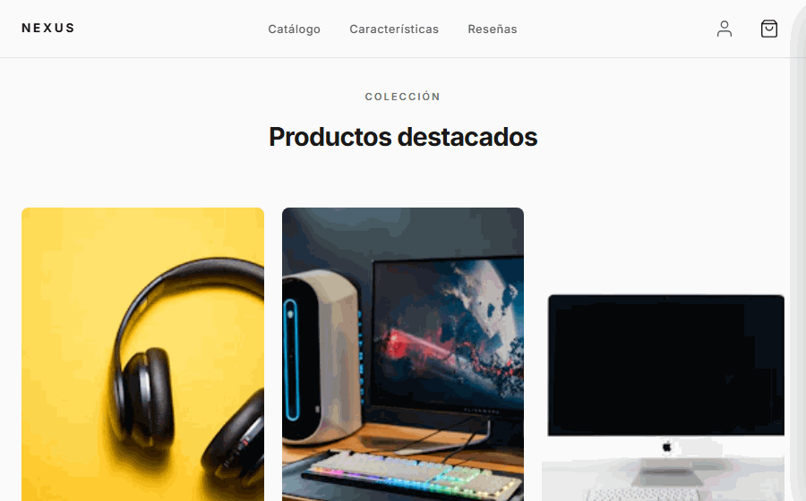
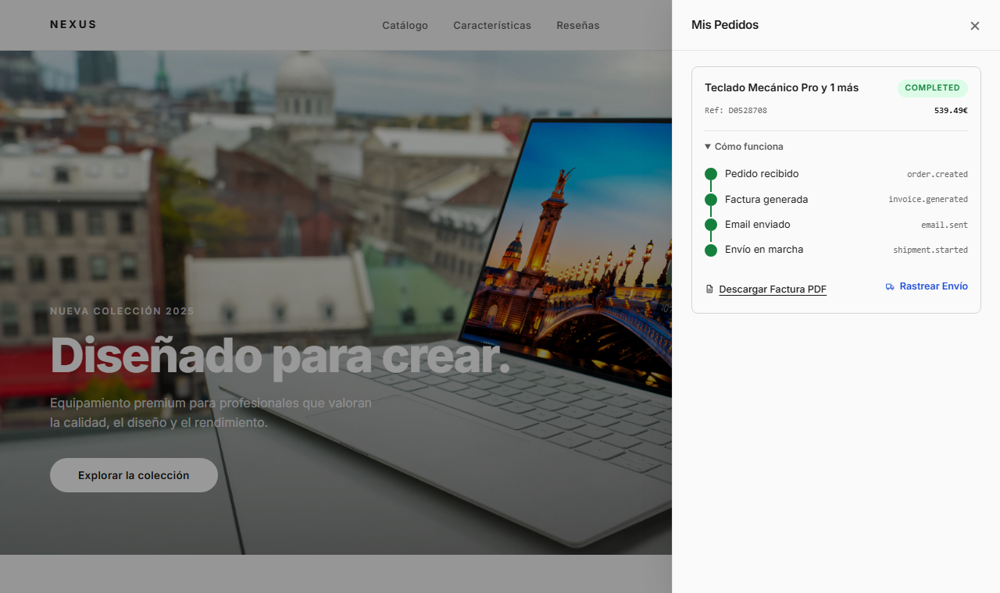
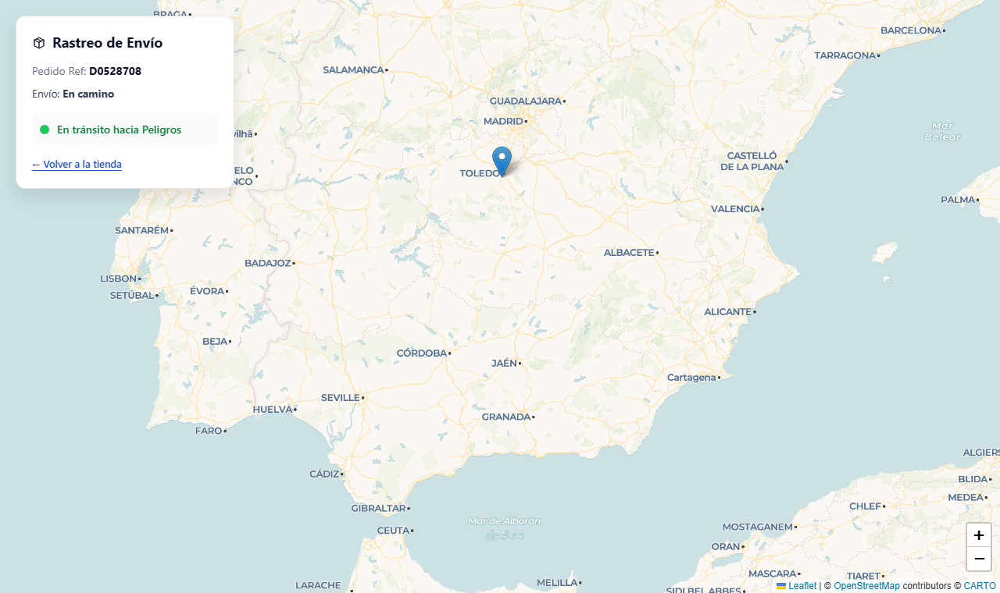
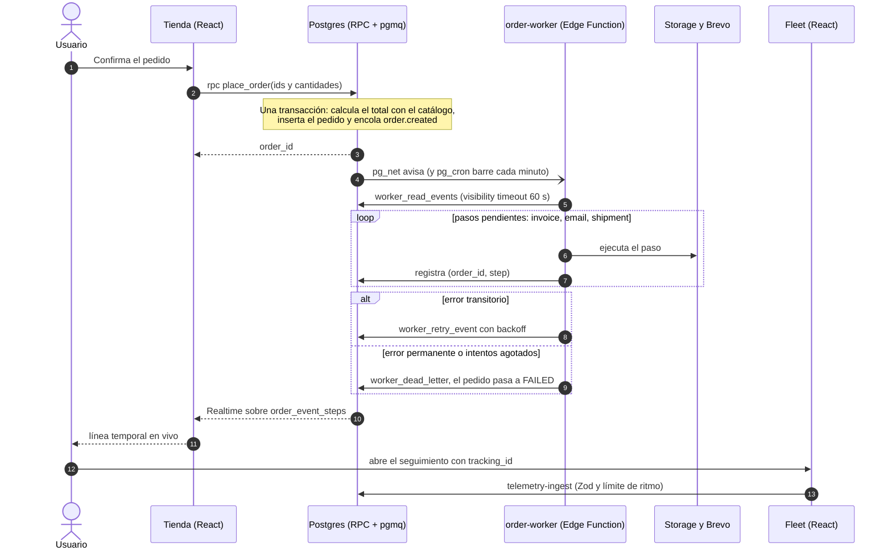
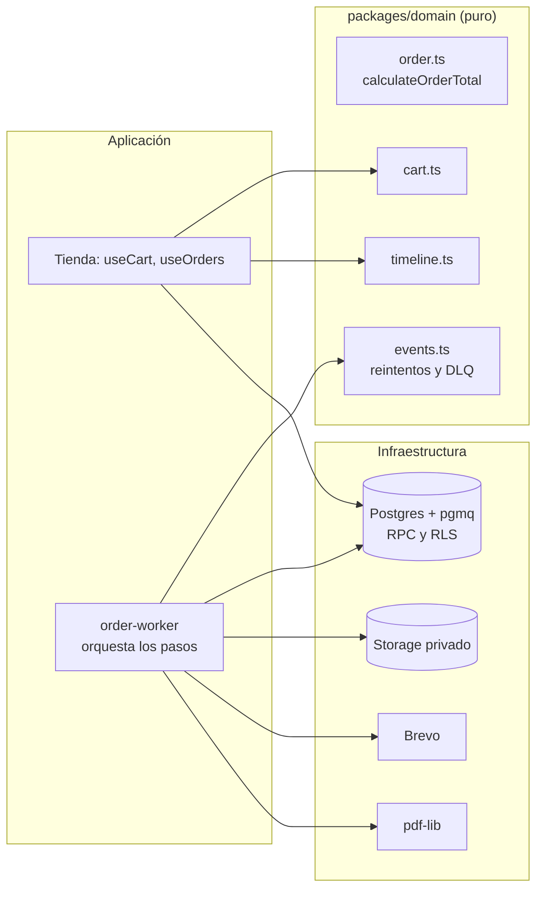

# Nexus Platform

[](https://github.com/Admaal/nexus-platform/actions/workflows/ci.yml)


-blueviolet)
[](LICENSE)

Una tienda online y un panel de seguimiento de flota enlazados por el id del pedido. Lo interesante no es la tienda, sino lo que ocurre al pulsar «Confirmar pedido»: un **flujo event-driven** con cola, pasos idempotentes, reintentos con backoff y cola de mensajes fallidos (DLQ), cuyo progreso se ve en vivo.

> Demo pública con datos de prueba. No uses datos personales reales.

## Demo en vivo

- **Tienda:** https://nexus-store-nu.vercel.app
- **Panel de seguimiento:** https://nexus-platform-fleet.vercel.app (se abre desde «Rastrear Envío» en un pedido)

Haz un pedido con datos ficticios y mira cómo avanza la línea temporal. La demo no envía correos (`EMAIL_PROVIDER=log`): la factura y el seguimiento funcionan igual.





*El pedido avanza por los eventos del backend y la interfaz lo refleja en tiempo real.*



## Qué demuestra

- **Backend event-driven sobre Postgres:** el pedido y el evento `order.created` se guardan en la misma transacción; un worker los consume con reintentos y DLQ ([ADR 0001](docs/adr/0001-cola-pgmq.md), [0003](docs/adr/0003-evento-transaccional-idempotencia.md), [0004](docs/adr/0004-reintentos-y-dlq.md)).
- **Seguridad en el servidor:** el cliente no decide el precio, no hay secretos en el navegador, las facturas son privadas ([0002](docs/adr/0002-precio-en-servidor.md), [0006](docs/adr/0006-facturas-privadas.md)).
- **Calidad medible:** dominio puro con mutation testing, tests de RLS con pgTAP, E2E con Playwright y auditoría de accesibilidad con axe, todo en CI ([0005](docs/adr/0005-dominio-puro.md), [0008](docs/adr/0008-tokens-y-accesibilidad.md)).

## Flujo de un pedido



## Arquitectura por capas

El dominio no depende de nada: lo comprueba una regla de ESLint. Los adaptadores (correo, PDF, almacenamiento) viven en el worker.



## Decisiones y trade-offs

| Decisión | Por qué | Coste |
| --- | --- | --- |
| [pgmq en lugar de Pub/Sub](docs/adr/0001-cola-pgmq.md) | Sin infraestructura nueva y el encolado es transaccional | No escala como un broker; hace falta despertar al worker |
| [RPC `place_order` en lugar de INSERT con RLS](docs/adr/0002-precio-en-servidor.md) | El servidor valida y calcula el total | Reglas duplicadas en SQL y dominio, sincronizadas por tests |
| [Evento en la misma transacción + pasos idempotentes](docs/adr/0003-evento-transaccional-idempotencia.md) | No se pierde ni se inventa un evento | Entrega «al menos una vez»: un email podría repetirse |
| [Reintentos y DLQ decididos en el dominio](docs/adr/0004-reintentos-y-dlq.md) | La política se prueba sin red | Sin jitter en el backoff |
| [Dominio puro compartido](docs/adr/0005-dominio-puro.md) | Mismo código en web y worker, con mutation testing | Importación por ruta relativa en Deno |
| [Facturas privadas con URL firmada](docs/adr/0006-facturas-privadas.md) | No basta el UUID para descargar datos personales | Los enlaces caducan |
| [Telemetría pública con límites](docs/adr/0007-telemetria-publica.md) | Un secreto en el navegador no protege nada | Quien conoce un id puede escribir telemetría, con límite |
| [Tokens de diseño y axe en CI](docs/adr/0008-tokens-y-accesibilidad.md) | La accesibilidad no se degrada sin que falle el CI | axe no sustituye una revisión manual |

El índice completo está en [`docs/adr`](docs/adr/README.md).

## Stack

| Capa | Tecnología |
| --- | --- |
| Tienda y panel de flota | React 19, Vite, TypeScript estricto, Leaflet |
| Backend | Supabase: Postgres (RPC, RLS, pgmq, pg_cron, pg_net), Auth anónima, Storage, Realtime, Edge Functions (Deno) |
| Dominio | `packages/domain`: TypeScript puro |
| Diseño | `packages/ui`: tokens y base de accesibilidad |
| Correo | Brevo (en local, `EMAIL_PROVIDER=log`) |
| Calidad | Vitest, Testing Library, Stryker, pgTAP, Playwright, axe |

## Probarlo en local

Requisitos: Node 22+, Docker y la CLI de Supabase (se usa con `npx`).

```bash
npm install

# 1. Base de datos, Auth, Storage y Realtime en local (aplica las migraciones)
npx supabase start -x studio,imgproxy,mailpit,logflare,vector,edge-runtime,postgres-meta,supavisor
npx supabase status -o env        # URL y claves locales

# 2. Edge Functions (worker y telemetría), sin enviar correos reales
cp supabase/.env.local.example supabase/.env.local
npx supabase functions serve --env-file supabase/.env.local --no-verify-jwt

# 3. Variables de las apps: usa la URL y ANON_KEY del paso 1
cp apps/store/.env.example apps/store/.env
cp apps/fleet/.env.example apps/fleet/.env

# 4. Tienda en :5173 y panel de flota en :5174
npm run dev
```

El worker se despierta solo con `pg_cron` (cada minuto) y, en producción, con `pg_net` tras cada pedido. En local puedes forzarlo:

```bash
curl -X POST http://127.0.0.1:54321/functions/v1/order-worker -H "X-API-Key: local-worker-secret"
```

## Tests

| Comando | Qué comprueba |
| --- | --- |
| `npm test` | Dominio (54), tienda (33) y fleet (8) con Vitest y Testing Library |
| `npm run mutation` | Mutation testing del dominio con Stryker; rompe por debajo del 75 % (hoy 100 %) |
| `npm run typecheck` | TypeScript estricto en apps, dominio, Edge Functions y E2E |
| `npm run test:db` | pgTAP: RLS, permisos, cola, DLQ, redrive y rate limit (35) |
| `node scripts/e2e-events.mjs` | Integración del worker: cola, pasos, idempotencia, factura firmada y telemetría |
| `npm run test:e2e` | Playwright: compra → factura → seguimiento, y auditoría axe WCAG 2.1 AA |

`scripts/gates.ps1 full` ejecuta typecheck, tests, builds y mutation, como los hooks. El CI corre todo lo anterior en tres jobs (`gates`, `db-tests`, `e2e`) y un job agregador, `Gate obligatorio`.

No hay un informe de cobertura de líneas: la calidad del dominio se mide con mutation testing y la de la interfaz con tests de comportamiento y E2E.

## Estructura

```
apps/store            Tienda (React)
apps/fleet            Panel de seguimiento y simulador (React + Leaflet)
packages/domain       Lógica pura: pedido, carrito, reintentos, línea temporal
packages/ui           Tokens de diseño y base de accesibilidad
supabase/migrations   Esquema, RLS, RPC, cola y rate limit
supabase/functions    order-worker y telemetry-ingest (Deno)
supabase/tests        pgTAP
e2e                   Playwright (compra y accesibilidad)
docs/adr              Decisiones de arquitectura
```

## Seguridad

- El total del pedido lo calcula el servidor; `orders` no admite INSERT directo.
- `shipments` solo lo lee su propietario o quien conoce el `tracking_id`, y solo ve el estado.
- La cola y sus funciones `worker_*` solo las ejecuta `service_role`; el worker exige `X-API-Key`.
- Facturas en un bucket privado con URL firmada.
- `telemetry-ingest` es público por diseño y se defiende con validación, camiones conocidos y límite de ritmo ([ADR 0007](docs/adr/0007-telemetria-publica.md)).

**Nunca commitear:** `.env`, `service_role`, `BREVO_API_KEY`, ni `supabase/.temp/`.

## Cómo trabajo con IA

Uso agentes de IA con guardarraíles mecánicos en lugar de confianza: cada cambio de comportamiento empieza con un test en rojo, el dominio pasa por mutation testing, y hooks y CI ejecutan los mismos gates (`scripts/gates.ps1`). El fichero [`AGENTS.md`](AGENTS.md) recoge la fase actual, las reglas y cómo recuperar un checkpoint; el historial está en [`docs/fases.md`](docs/fases.md).

## Despliegue

Pasos para Vercel y Supabase en [`docs/DEPLOY.md`](docs/DEPLOY.md).

## Limitaciones conocidas

- Entrega «al menos una vez»: si el worker cae tras enviar el correo y antes de registrar el paso, el correo puede repetirse.
- Sin panel de administración de la DLQ: cada usuario ve el motivo del fallo de sus pedidos y puede reprocesarlos.
- El simulador de GPS corre en el navegador; un sistema real autenticaría al dispositivo.

## Licencia

MIT
